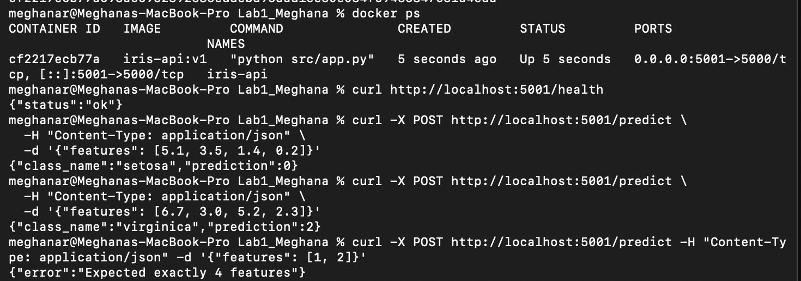
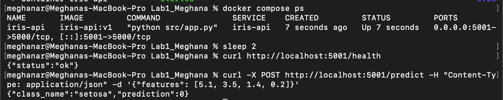

# Docker Lab 1: Containerized Iris Classifier API

A Flask API that serves a RandomForest Iris classifier inside a Docker container. The model is trained during the image build (`RUN python src/train.py`), so every container starts with a ready-to-use model baked in.

## Project Files

- `src/train.py`: trains the RandomForest model and saves it to `model/model.pkl`
- `src/app.py`: Flask API with `/health` and `/predict` endpoints
- `Dockerfile`: builds the image (installs dependencies, copies code, trains the model)
- `docker-compose.yml`: runs the same container with one command

## Build and Run

```bash
docker build -t iris-api:v1 .
docker run -d -p 5001:5000 --name iris-api iris-api:v1
```

Port 5001 is used on the host because macOS uses port 5000 for AirPlay Receiver.

## Test

```bash
curl http://localhost:5001/health
curl -X POST http://localhost:5001/predict -H "Content-Type: application/json" -d '{"features": [5.1, 3.5, 1.4, 0.2]}'
```

Expected output: `{"class_name":"setosa","prediction":0}`

## Run with Docker Compose

```bash
docker compose up -d --build
docker compose down
```

## Save and Load the Image

```bash
docker save iris-api:v1 -o iris-api-v1.tar
docker load -i iris-api-v1.tar
```

## Observations

- Test accuracy: 0.90 on a 30-sample held-out split.
- Layer caching: dependencies are installed before the source code is copied, so a rebuild with no changes finished in under 1 second, with every step `CACHED`.

## Screenshots

API running in a container:



Running with Docker Compose:


